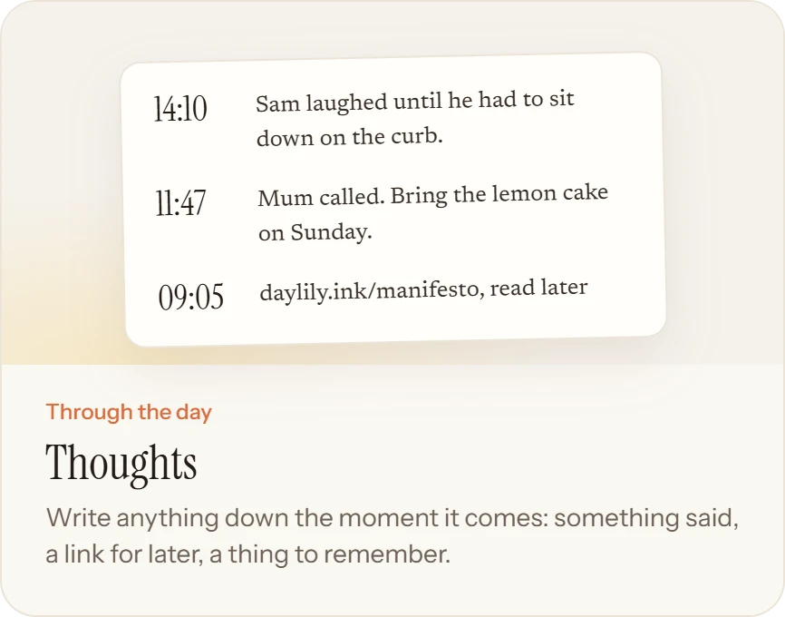
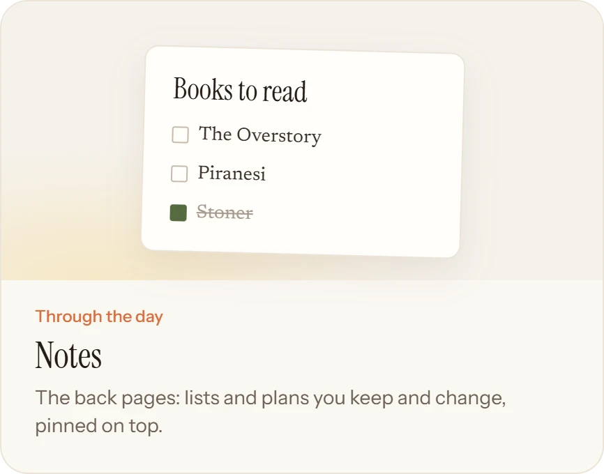
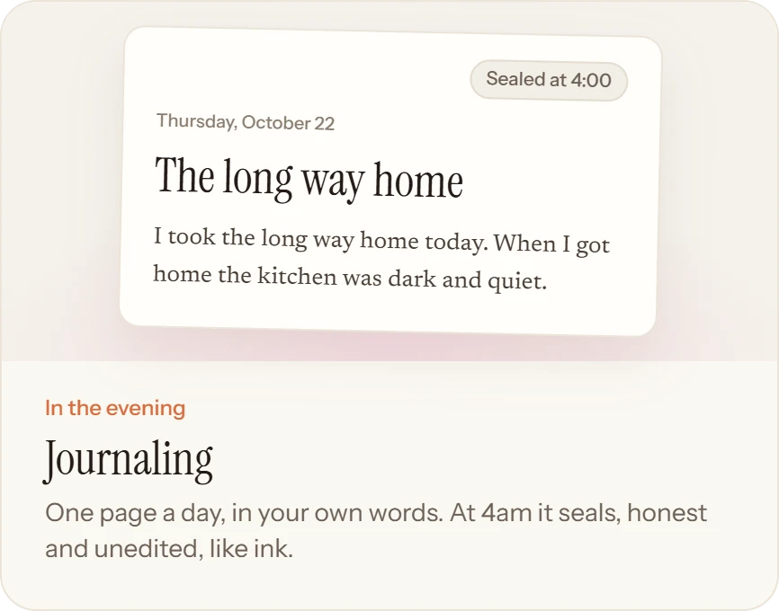
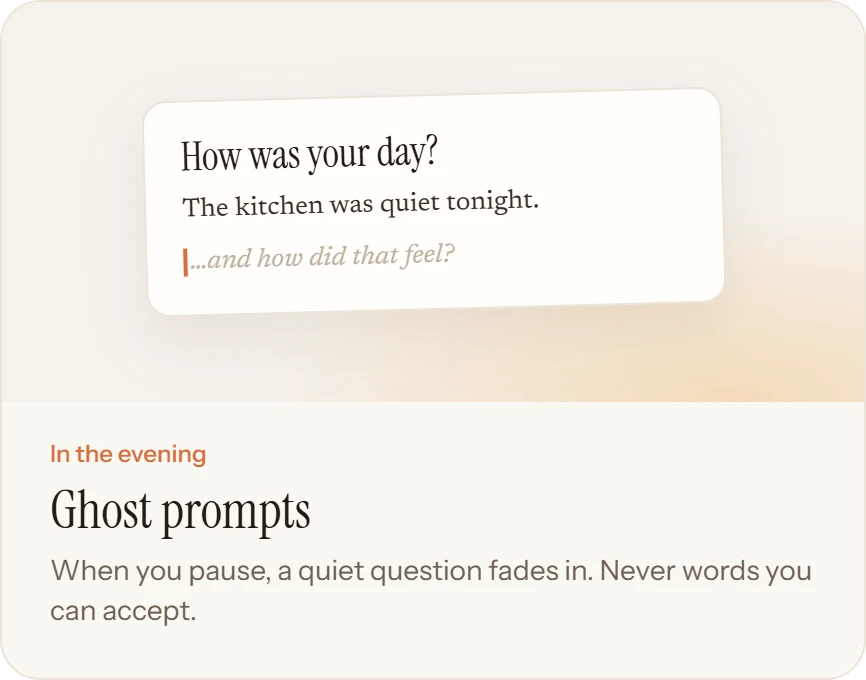
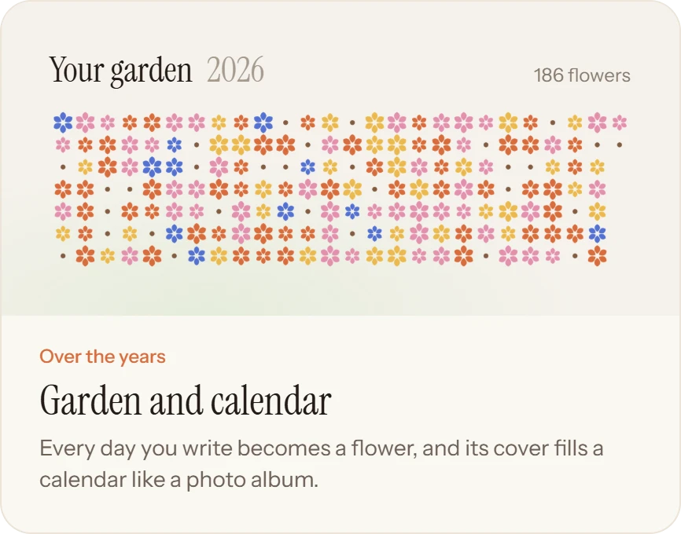
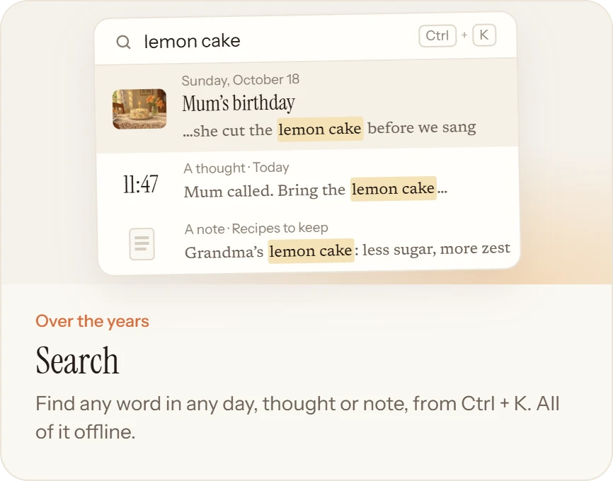

<p align="center">
  
</p>

<p align="center">
  <a href="https://daylily.ink/download/mac"></a>
  <a href="https://daylily.ink/download/windows"></a>
  <a href="https://daylily.ink/download/linux"></a>
</p>

<p align="center">
  Free and open source ·
  <a href="https://daylily.ink/changelog">Changelog</a> ·
  <a href="https://daylily.ink/roadmap">Roadmap</a> ·
  <a href="https://daylily.ink/privacy">Privacy</a> ·
  <a href="https://daylily.ink">Website</a>
</p>

Daylily is a journal for your whole day, in your own words. Jot thoughts as they come, keep notes you change, and each
evening write one page about how it went. At 4am the page seals, honest and unedited, and a flower opens in your
garden.

Most journaling apps want to write your journal *for* you. **Daylily goes the other way:** it asks, it listens, and
every word stays yours, in plain markdown files on your computer.

<p align="center">
  
</p>

## A day with Daylily

From a thought in the morning to a garden years later. Each one has its own page on the website.

<p align="center">
  <a href="https://daylily.ink/features/thoughts"></a>
  <a href="https://daylily.ink/features/notes"></a>
  <a href="https://daylily.ink/features/journaling"></a>
  <a href="https://daylily.ink/features/ghost-prompts"></a>
  <a href="https://daylily.ink/features/garden"></a>
  <a href="https://daylily.ink/features/search"></a>
</p>

<p align="center">
  
</p>

## What Daylily believes

1. **Written by you.** Every word is yours. When AI comes, it asks and answers; it never writes, rewrites or
   summarises into your journal, and it's off until you turn it on.
2. **Kept by you.** Plain markdown in a folder you own, readable in any app and in twenty years. Each page seals at
   4am, like ink. Nothing leaves your computer unless you choose.
3. **Grown into a garden.** Every day you write plants a flower. A missed day is bare soil, never guilt.

The full story is in the [manifesto](https://daylily.ink/manifesto), and what leaves your computer (almost nothing)
is on the [privacy page](https://daylily.ink/privacy).

## Your journal is a folder

One folder per day, holding the page, its thoughts and its pictures, and one file for each note. Open them in any
editor, grep them, sync them with anything, or read them in twenty years.

```
~/Daylily/
  2026/10/26/
    2026-10-26.md        # the page: title, cover, the day in markdown
    thoughts.md          # the day's thoughts, each under its time
    cover.jpg
    image-01.jpg
  notes/
    books-to-read.md     # one file per note, named from its title
    images/
  .daylily/config.json   # your reminder time and preferences
```

## Install

Download the latest release for your computer from the [download page](https://daylily.ink/download) or
[GitHub Releases](https://github.com/KacemMathlouthi/Daylily/releases/latest).

| System | File | First launch |
|---|---|---|
| macOS 13 or later | [Apple silicon](https://daylily.ink/download/mac) · [Intel](https://daylily.ink/download/mac-intel) `.dmg` | Drag Daylily to Applications, then right-click it and choose **Open** |
| Windows 10 or later | [`setup.exe`](https://daylily.ink/download/windows) | **More info**, then **Run anyway** |
| Linux | [`.AppImage`](https://daylily.ink/download/linux) · [`.deb`](https://daylily.ink/download/deb) | `chmod +x` the AppImage and run it, or `sudo apt install ./daylily_*.deb` |

> [!NOTE]
> Builds aren't signed yet, so macOS and Windows warn you the first time. If macOS still refuses, run
> `xattr -cr /Applications/Daylily.app`. Signed builds are on the roadmap. Each release lists its
> [checksums](https://daylily.ink/download/checksums).

## Build it yourself

Daylily is an Electron app in a pnpm monorepo. You need Node 24 and pnpm.

```sh
git clone https://github.com/KacemMathlouthi/Daylily
cd Daylily
pnpm install
pnpm dev              # the app and the website
pnpm journal:seed     # optional: a sample year and a half of days in ~/Daylily
```

- `apps/desktop`: the Electron app
- `apps/web`: the website
- `packages/core`: days, sealing and flowers, with no UI
- `packages/ui`: the design system and the page editor

Want to help? Start with [CONTRIBUTING.md](CONTRIBUTING.md).

## Where it's growing

The same day, a little further.

- **Through the day, everywhere:** Daylily on your phone, and sync through git, your own bucket or a hosted option.
- **In the evening:** ghost prompts that listen to what you just wrote.
- **Over the years:** look-backs from weekly to yearly, ask your journal, a year in review, a printed book of a year.
- **Always:** export, and a journal you can lock.

AI arrives as a companion: off until you turn it on, any provider or a model on your own computer, and plain about
what it sends. See the [roadmap](https://daylily.ink/roadmap) and the [changelog](https://daylily.ink/changelog), and
[suggest a change](https://github.com/KacemMathlouthi/Daylily/issues/new?template=suggestion.yml) anytime.

## License

[AGPL-3.0](LICENSE). Free and open source, now and always.

<p align="center">
  
</p>
