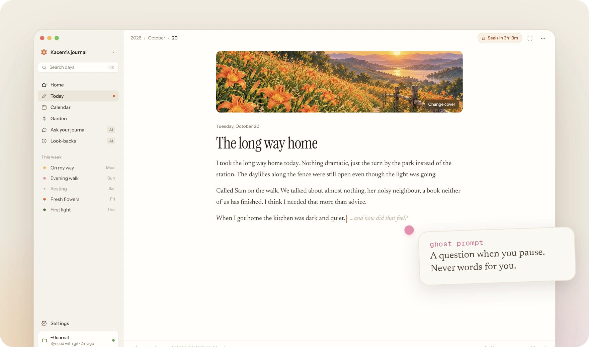
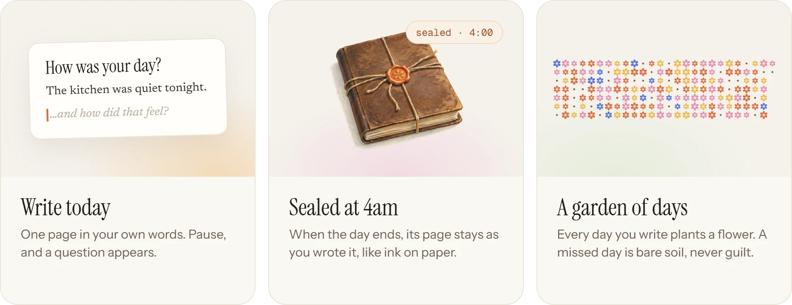

<p align="center">
  
</p>

<p align="center">
  <a href="https://daylily-silk.vercel.app/download/mac"></a>
  <a href="https://daylily-silk.vercel.app/download/windows"></a>
  <a href="https://daylily-silk.vercel.app/download/linux"></a>
</p>

<p align="center">
  Free and open source ·
  <a href="https://daylily-silk.vercel.app/changelog">Changelog</a> ·
  <a href="https://daylily-silk.vercel.app/roadmap">Roadmap</a> ·
  <a href="https://daylily-silk.vercel.app">Website</a>
</p>

Most journaling apps want to write your journal *for* you: AI summaries, chat-to-entry, auto-titles. **Daylily goes
the other way.** Its whole job is to get you to sit down each evening and say what happened, and how it felt, in your
own words.

Today is the only page you can write. At 4am it seals, honest and unedited, and becomes a flower in your garden. Your
days are plain markdown files in a folder you own.

<p align="center">
  
</p>

<p align="center">
  
</p>

<p align="center">
  
</p>

## What Daylily believes

1. **One page a day.** Today is the only page you can write. When the day ends it seals, like ink.
2. **It draws more out of you.** It opens on *"How was your day?"* and, when you pause, asks a little more.
3. **Your days grow into a garden.** Every day you write plants a flower.
4. **Your files are yours.** Plain markdown in a folder you own. No lock-in, ever.
5. **AI asks. It never writes for you.** When it comes, it stays off until you turn it on, one feature at a time.
6. **Welcome back, never guilt.** No streaks, no wilting. A missed day is bare soil.

The full story is in the [manifesto](https://daylily-silk.vercel.app/manifesto).

## Your journal is a folder

One folder per day, holding the page and its pictures. Open it in any editor, grep it, sync it with anything, or read
it in twenty years.

```
~/Daylily/
  2026/10/24/
    2026-10-24.md          # title, cover, the day in markdown
    cover.jpg
    image-01.jpg
  .daylily/config.json     # your reminder time and preferences
```

## Install

Download the latest release for your computer from the [download page](https://daylily-silk.vercel.app/download) or
[GitHub Releases](https://github.com/KacemMathlouthi/Daylily/releases/latest).

| System | File | First launch |
|---|---|---|
| macOS 13 or later | [Apple silicon](https://daylily-silk.vercel.app/download/mac) · [Intel](https://daylily-silk.vercel.app/download/mac-intel) `.dmg` | Drag Daylily to Applications, then right-click it and choose **Open** |
| Windows 10 or later | [`setup.exe`](https://daylily-silk.vercel.app/download/windows) | **More info**, then **Run anyway** |
| Linux | [`.AppImage`](https://daylily-silk.vercel.app/download/linux) · [`.deb`](https://daylily-silk.vercel.app/download/deb) | `chmod +x` the AppImage and run it, or `sudo apt install ./daylily_*.deb` |

> [!NOTE]
> Builds aren't signed yet, so macOS and Windows warn you the first time. If macOS still refuses, run
> `xattr -cr /Applications/Daylily.app`. Signed builds are on the roadmap. Each release lists its
> [checksums](https://daylily-silk.vercel.app/download/checksums).

## Build it yourself

Daylily is an Electron app in a pnpm monorepo. You need Node 24 and pnpm.

```sh
git clone https://github.com/KacemMathlouthi/Daylily
cd Daylily
pnpm install
pnpm dev              # the app and the website
pnpm journal:seed     # optional: a sample year and a half of days in ~/Daylily
```

- `apps/desktop`: the Electron app
- `apps/web`: the website
- `packages/core`: days, sealing and flowers, with no UI
- `packages/ui`: the design system and the page editor

Want to help? Start with [CONTRIBUTING.md](CONTRIBUTING.md).

## Where it's growing

Search, a welcome for your first run and updates that install themselves are next. Then richer days, AI that asks but
never writes, and your journal everywhere you write. See the [roadmap](https://daylily-silk.vercel.app/roadmap) and the
[changelog](https://daylily-silk.vercel.app/changelog), and
[suggest a change](https://github.com/KacemMathlouthi/Daylily/issues/new?template=suggestion.yml) anytime.

## License

[AGPL-3.0](LICENSE). Free and open source, now and always.

<p align="center">
  
</p>
